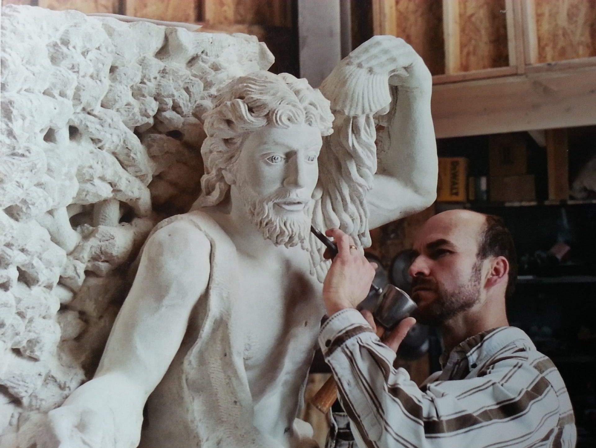
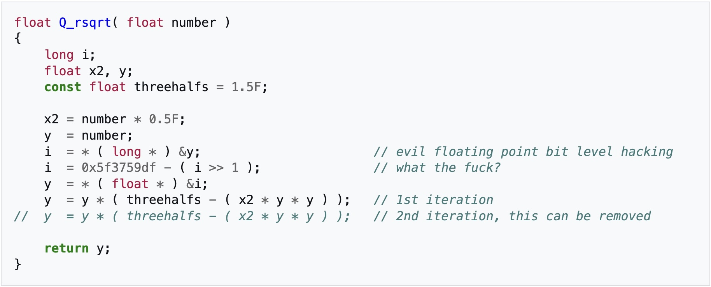
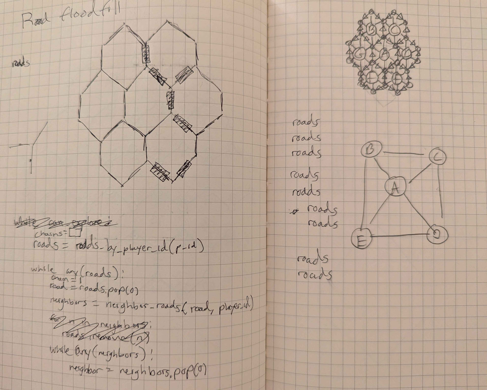
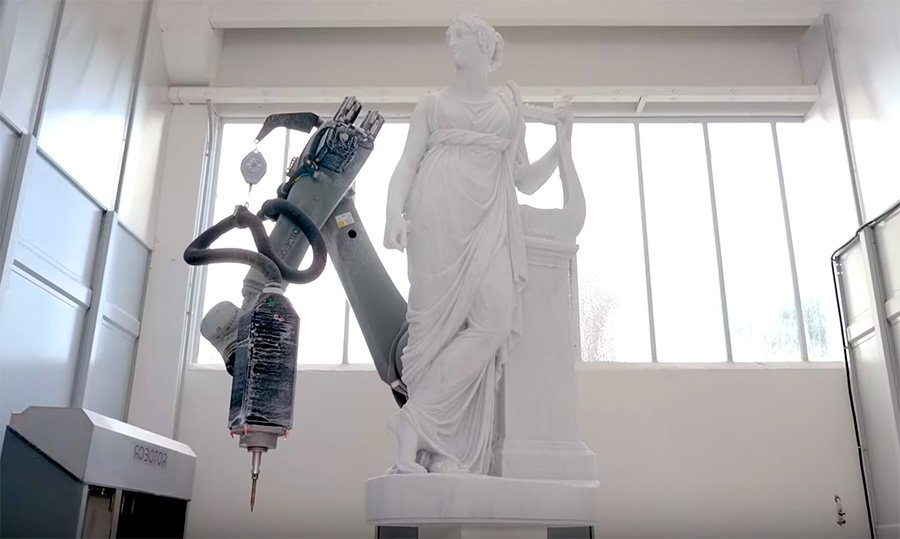

# Sculpting Good Code

*May 7, 2026*

Recently, I've been having what I can only describe as an identity crisis as a programmer. Not everyone may agree, but I know there are those who do, as I do, that there is an **art** in writing good software. I look at some of the greats, [John Carmack](https://en.wikipedia.org/wiki/John_Carmack) for example (he wrote Doom), an absolute legend of a programmer. I remember years ago listening to him on [Lex Fridman's podcast](https://www.youtube.com/watch?v=I845O57ZSy4); 5 HOURS of nonstop nerding out over software. Hearing stories about what he had to do in the early days to be able to write video games. Inventing techniques to render images to the screen on the Apple II (because it didn't exist). Developing algorithms like [fast inverse square root](https://en.wikipedia.org/wiki/Fast_inverse_square_root) to efficiently calculate angle of incidence and reflection for lighting in games.

These kinds of stories would motivate me to become a better programmer. I wanted to emulate (as much as I could) the feeling of discovering clever solutions to problems. Obviously the problems we have today are not as low-level, rendering graphics is a solved problem. But there are other problems, unique to the time we are in. And then theres always just building things for yourself, either to challenge yourself intelectually, or to learn something new.

I love getting sucked into a problem. When I'm in it, I'm in so deep that it is sometimes hard to get out even for brief periods to eat, sleep, (ya know). I know many programmers out there can relate. One of my favorite example memories of this was a few years ago, begining of 2022. I just left my first job in search of something new. Every day I would go to the local coffee shop where my friend worked. I would sit there all day and browse LinkedIn. Or at least, thats what I shouldve been doing. What I actually was doing was working on a Python engine for Settlers of Catan; [Pytan](https://github.com/greerviau/Pytan). I had just gotten off re-watching the Alpha-GO documentary and wanted to try my hand at building an AI to play Catan. I thought it would be an interesting challenge since Catan is an imperfect information game. I had made game AIs in the past for simpler games; [SnakeAI](https://github.com/greerviau/SnakeAI); [TetrisAI](https://github.com/greerviau/TetrisAI); and like those, I first had to start with a programatic version of the game that I could control. I had done some research, and there were actually engines out there for this; [catan-py by rosshamish](https://github.com/rosshamish/catan-py). But I didnt want to do that, I wanted to try my hand at writing it myself, not because it actually would get me towards making the AI faster (quite the opposite), but because I thought it would be fun.

I ended up spending 3 months writing the engine and never actually got around to building the AI like I originally intended. I became obsessed, from the very beginning there were problems I had never dealt with before. Example: how do you reprsent a hexagonal grid system, and in a way that you can track each index and vertex easily? (Turns out you can do it with hexidecimal codes; [hexmesh.py](https://github.com/greerviau/Pytan/blob/main/pytan/core/hexmesh.py)). How do you do a flood fill through the edges of this hexagonal grid system to do things like detect longest road, find intersections to impose game rules? I have pages in my notebook trying to work through these kinds of problems.

Cut to today, I go to work, open Claude Code, and describe what I need it to do. Within minutes, hundreds of lines of code that do >90% of what I want. I tweak a few things here and there (Claude gaslights me into thinking it made the changes I did) but most of the code I'm committing is in one way or another being either written or touched by Claude. The hard truth is, it works, and it makes me way more productive (at least it feels that way). If I were to not use it, my velocity would grind to a halt and I would fall behind my colleagues. Claude isnt doing anything I could not do reasonably myself. What it does do is save me hours of researching Stack Overflow, and just physical hands on keyboard. Its just hard to compare my 90wpm typing speed with hundreds of tokens/sec.

Now as far as industry is concerned, I will conceed to the notion that code is a "means to an end". In an industry setting, your manager doesnt care about how much pride you take in the code you wrote. They dont care how elegant a function is, or how clean the type signature is. All anyone really cares about at the end of the day is "does it work". Now yes, I am grosely simplifying and there are lots of concerns around AI bloating software stacks, writing unmaintainable code, etc. Those topics are largely outside the scope of what I am to highlight in this post, I have lots of thoughts but I dont really want to over index here on industry so I'll save those thoughts for another post. 

There was a recent blog post I saw on Hacker News titled **Agentic Coding is a Trap**. I agreed and disagreed with many of the points made, but one that resinated with me was this idea of mental fatigue when faced with writing code by hand again. Being "rusty" is a phenomenon I have actually noticed in myself. Now me being rusty at hand writing code in the workplace may not be that big of a deal since I am using Claude anyway. Although I do always make the meme at work whenever Claude goes down that "its time to break out the hammer and chisel". I do however get worried about the younger, less experienced generations reliance on the tools. Especially considering they will eventually become the senior, staff, principal engineers in the future. Maybe by that time AI will have taken over the world, but I like to think that we will all still be here, and that software engineers will still be needed. Again, I will save my thoughts on its affects in industry for another post.

However, when I go home and want to work on personal projects, it is actually very diffucult to do so without my brain wanting to lean on Claude for the hands on keyboard, and unlike the code Im writing at work, Im doing it for myself, for my own understanding, for fun. I recently wanted to start learning rust and I thought a chess engine would be a great way to start. Take the approach I have done in the past, start basic, optimize, improve, learn as you go. 2 weeks later and Im still staring at an empty project folder. The thought of using Claude keeps crossing my mind, but why? I want to build this for me, to learn, Claude will take that all away from me. All I want is to do a little trad programming but making myself do it when my hippocampus knows how easy it is to use Claude makes it difficult. 

I also just dont feel as smart, I feel faster, but is that really all that matters? Maybe one day when/if these models can do everything themselves it wont matter, but as long as I'm behind the wheel, I want to feel like I can take over at any time (this is why I like my [comma](https://comma.ai/)).

Finally I come to the point I wanted to make this whole time. I often use the analogy of marble sculpting to describe how I feel whats happening with programming right now. When I look at a sculpture, I apprecite the time, craft, intent that went into creating it. When it comes to art, to me these things matter. I want to know that there is someone behind the piece that really took their time and dedicated themsevles to creating something. Now if there are 2 sculptures side by side, and you tell me one is made by a robot, some people might say "does it matter? As long as the piece is pleasing to look at, does it matter if a person made it or not?". Everyone is entitled to their opinion on this, but to me, yes, it does. Because to me, art is about more than just the result. It is about that human element, the time, tallent and intent behind a piece. I dont want more quantity of sculpture, to me that just deminishes the value of real good sculpture. 

Now in the industry of marble sculpting, many real tallented sculpters have adopted robotics as a "means to an end". Most of marble sculpting is a very laborious, time consuming, unhealthy process. Chipping away large chunks just so you can finally get down to the details. Many of these sculpters lean on robotics to do that dirty work so they can work on waht matters to them, the details. This to me strikes a middle ground of involvement,
